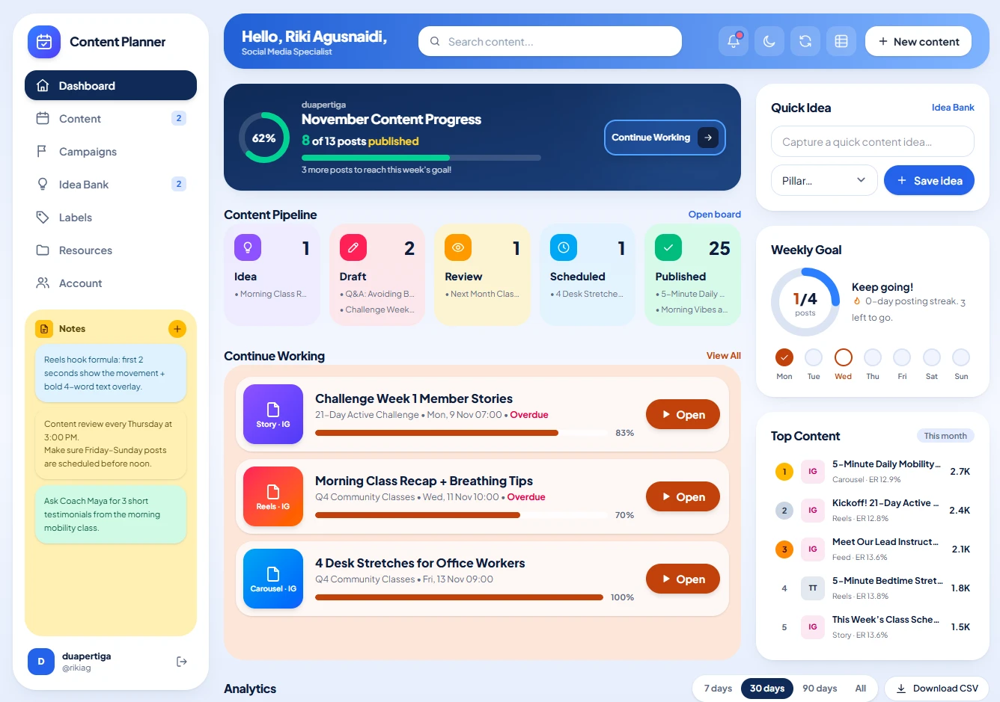
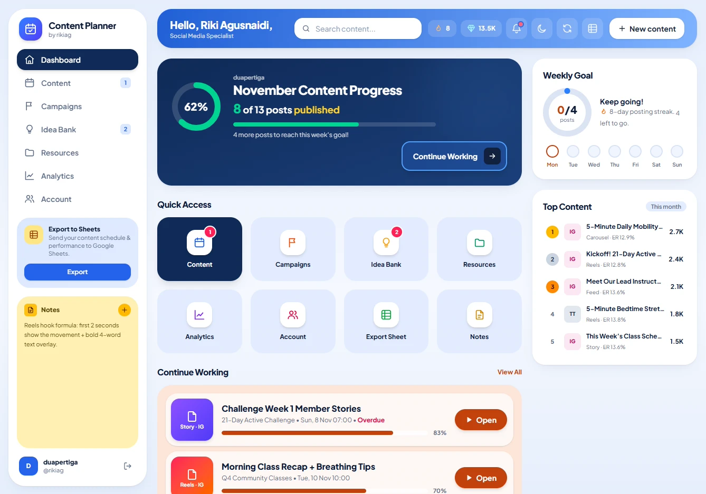

# Changelog

All notable changes to **Content Planner** will be documented in this file.

The format is based on [Keep a Changelog](https://keepachangelog.com/en/1.1.0/), and this project adheres to [Semantic Versioning](https://semver.org/spec/v2.0.0.html).

## [Unreleased]

### Added
- **Offline Mode when the server is down** (e.g. Cloudflare Tunnel **Error 1033** / HTTP 530, 502, 521, 522, 523, power or network outages at the host): the Service Worker now treats these responses like a lost connection and serves the cached app instead of the Cloudflare error page.
- **Encrypted offline outbox**: form submissions and inline actions (status changes, quick ideas, notes, deletes…) made while offline are stored in IndexedDB, encrypted with AES-GCM 256 using a non-extractable, device-only key, and **synced automatically** in order when the server is reachable again (Background Sync where supported, plus health-check polling).
- **Offline / sync status bar** at the top of every page ("Server is offline… your changes are saved securely on this device and will be synced automatically"), with a **Details** panel to review, retry, or discard pending changes.
- `GET /api/session` health-check endpoint (returns sign-in state and a fresh CSRF token, same-origin only).
- Main pages are pre-cached after sign-in (at most every 6 hours) so they open even if they were never visited before the outage.

### Security
- Sensitive routes (`/login`, `/register`, `/logout`, `/account/*`, `/export/*`) and any field named like a password are **never** stored offline; CSRF tokens are never persisted (a fresh token is fetched at sync time).
- Queued changes are bound to the signed-in account and are only replayed into that same account; replays carry an idempotency key (`X-CP-Replay-Id`) so a change is never applied twice.
- Logging out wipes cached pages, the offline outbox, and its encryption key from the device (with a warning if unsynced changes exist). Queued changes expire after 14 days.

## [1.4.0] - 2026-11-17

### Added
- **Campaign Content Views & Filters**: Added **List**, drag-and-drop **Board**, and **Day / Week / Month Calendar** views with search, **Platform**, **Status**, and **Order By** filters inside the Campaign detail page (`/campaigns/{id}`).
- **Content Order By**: Added an **Order by** selector on `/content` and Campaign detail views (`Closest to now` by default, plus `Earliest schedule`, `Latest schedule`, `Recently added`, `Title (A–Z)`, and `Most views`).
- **Saved Content View State**: Persisted the last selected `/content` view (`list`, `board`, or `calendar`) in `localStorage` (`cp-content-view`) while keeping explicit `?view=` URL links working.

### Changed
- **Welcome Page (`/welcome`)**: Updated the feature grid (12 cards), interactive workflow preview tabs, and application routes table to reflect all current features (drag-and-drop Kanban, Day/Week/Month calendar, Order By, saved view state, Custom Labels, Markdown editor & safe preview, Campaign views, and inline Idea editing).
- Refactored the Content and Campaign detail workspaces to share `render_content_workspace()` / `content_workspace_state()` in PHP and `createContentWorkspace()` in `public/assets/app.js`.

### Fixed
- Updated the GitHub `LICENSE` link on the Welcome page from `/blob/main/LICENSE` to `/blob/master/LICENSE` to match the repository's `master` default branch.

## [1.3.0] - 2026-11-16

### Added
- Simple Markdown editor with formatting toolbar (Bold, Italic, Heading, Bullet/Numbered lists, Quote, Code, Link) and live Write/Preview toggle for Content **Caption / Script**, Campaign **Goal / Objective**, and Idea **Notes / Outline**.
- XSS-safe Markdown rendering in the Content detail modal, Campaign detail view, Campaign cards, and Idea Bank cards.
- Edit Idea modal in the Idea Bank so ideas can be edited inline without leaving the page (preserving active filters and pagination).

### Changed
- Improved status and pillar chip padding (`px-3 py-1.5 leading-none`) on Idea Bank cards.
- Updated `action_idea_save` to redirect back cleanly using `safe_back()`.

### Fixed
- Stacked the **Continue Working** button below the monthly progress section on mobile in the Dashboard hero card, and refined hero gap spacing.
- Dispatched `input` events from the Markdown editor toolbar so Alpine `x-model` stays synchronized when formatting text.

## [1.2.0] - 2026-11-12

### Added
- Sidebar now shows the latest 3 colored notes, with a detail modal.
- Search filter on the Campaigns page.
- Pagination for the Idea Bank and for content in the Campaign detail page.
- Board view limits each column to 5 items, with a "View all" button.
- Month calendar view shows the "Selected Date" side panel only in Month mode.
- Weekly Goal days on the dashboard link to the calendar day view.
- Search form on mobile can be toggled via an icon button in the navbar.

### Changed
- Renamed **Categories** to **Labels** across navigation and content.
- Dashboard layout: Quick Idea moved above Weekly Goal, and Analytics is now full width below the main columns.
- "About" and "What's new" links moved from the sidebar to the footer; sidebar version/author info removed and footer spacing added.
- Status filter pills are hidden in Board view.
- Cancel button on forms now navigates back to the previous page.
- Active view and calendar mode persist across page reloads.
- Mobile polish: pagination bar centered, delete buttons show only a trash icon, campaign delete button inlined in the form footer.
- Refined note section styling, form background color, status select styling, and equal column heights on the board.

### Fixed
- Service Worker "response clone" error.
- Label modal click-outside race condition; label input is now auto-focused.
- "In progress" filter, week view borders, and horizontal rendering of the calendar week view.
- Date numbers now display in month calendar cells.
- Content detail modal footer padding and Continue Working button padding.
- Idea save button state and responsive layout CSS.
- Overflow behavior in week view and an unnecessary class on the home hero section.

## [1.1.1] - 2026-11-10

### Added
- Changelog "seen version" store, dynamic Service Worker version query, and version badges, changelog links, and recent releases in layout, account, and landing pages.

### Changed
- Improved Service Worker versioning and cache handling; legacy Service Worker caches are purged.
- Refined security headers and permissions policy.
- Enhanced theme application in the layout.

## [1.1.0] - 2026-11-10

### Added
- Custom workspace categories (`/categories`): create, edit, and delete Platforms, Formats, Content Pillars, and Pipeline Statuses with custom color badges, abbreviations, icons, and default progress percentages.
- Interactive Kanban board drag-and-drop: drag content cards across status columns to update their stage instantly without reloading the page.
- Multi-mode Calendar view: switch between **Day**, **Week**, and **Month** calendar views with a companion side panel showing scheduled posts for the selected date.
- Global Content Detail modal: preview full captions, hashtags, schedule, completion progress, and performance metrics—or copy text and change status inline—from any view.
- Dashboard quick idea capture and embedded analytics overview with compact monthly progress rings.
- Client-side pagination on the Content list and Campaign detail pages, plus instant reactive status and pillar filtering in the Idea Bank.
- Dedicated `/changelog` page, landing page release timeline, and "New" release indicator in navigation.

### Changed
- Redesigned sidebar, top navbar, and single-row form action bars for a cleaner mobile and desktop layout.
- Improved `<select>` dropdown styling and touch targets on mobile screens.
- Simplified runtime version check to require `PHP >= 8.2.35`.

### Fixed
- Centered the reminders popover on small mobile viewports so notifications stay fully visible within screen bounds.

### Security
- Bumped Service Worker cache version (`cp-v1.1.0`) and isolated dynamic category mutations behind CSRF-verified endpoints.

### Upgrade
- **No manual database migration required.** Custom category settings are stored automatically in your existing per-user SQLite `settings` table (`data/users/{id}.sqlite`). Pull the latest changes (`git pull`) and hard-refresh your browser (`Ctrl/⌘ + Shift + R`) so the updated Service Worker activates.

## [1.0.0] - 2026-11-09
### Added
- Initial public release of **Content Planner** (PHP >= 8.2.35, SQLite WAL, Tailwind CSS 4, Alpine.js 3).
- Content pipeline with List, 5-stage Kanban Board (`Idea → Draft → Review → Scheduled → Published`), and Monthly Calendar views.
- Goal-driven Campaigns (`/campaigns`) with date ranges, color gradients, progress bars, total views, and average engagement rate (`ER%`).
- Idea Bank (`/ideas`) with priority tagging, content pillars, and one-click **Turn into post** conversion.
- Templates, Hashtags & Brand Vault (`/resources`) with one-click clipboard copy and pinned Sticky Notes (`/notes`) synced to the sidebar.
- Performance Analytics (`/analytics`) with 7/30/90-day period comparisons, 8-week view trend chart, and best publishing day breakdowns.
- Zero-auth Google Sheets TSV copy, formula-safe UTF-8 CSV exports, and full workspace JSON backup (`/export`).
- Installable Progressive Web App (PWA) with offline page caching (`sw.js`) and flicker-free System / Light / Dark themes.

### Security
- Enforced `PHP >= 8.2.35` runtime check patched against critical PHP2Shell vulnerabilities.
- Physical per-user SQLite database isolation (`data/auth.sqlite` for accounts + dedicated `data/users/{id}.sqlite` per workspace).
- Hardened authentication with `password_hash(PASSWORD_DEFAULT)`, session ID regeneration, `HttpOnly` + `SameSite=Lax` cookies, per-request CSRF tokens, strict CSP nonces, and login brute-force rate limiting (5 attempts per 15 minutes).
