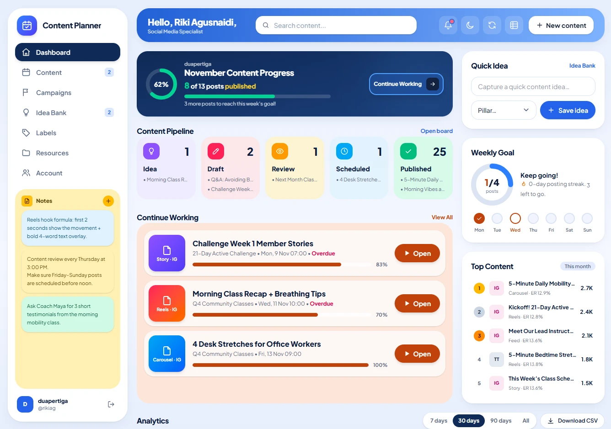

# Content Planner

[](CHANGELOG.md)
[](https://www.php.net/)
[](LICENSE)

A lightweight, free, and open-source self-hosted social media content planner built with **PHP (>= 8.2.35) · SQLite · Tailwind CSS 4 · Alpine.js 3**. Features a mobile-first UI, light/dark themes, physical multi-user SQLite workspace isolation, an interactive landing page, and Progressive Web App (PWA) support.

- **Live Demo:** [https://rikiag.com/content-planner/](https://rikiag.com/content-planner/)
- **Repository:** [https://github.com/rikiag/content-planner](https://github.com/rikiag/content-planner)
- **Changelog & Release Notes:** [View changelog (`CHANGELOG.md`)](CHANGELOG.md) · [GitHub Releases](https://github.com/rikiag/content-planner/releases) · [Atom Feed](https://github.com/rikiag/content-planner/releases.atom)
- **License:** [MIT License](LICENSE)



---

## Quick Start

> **Latest Release: `v1.2.0`** — [View changelog (`CHANGELOG.md`)](CHANGELOG.md) for new features, security updates, and upgrade instructions.

### 1. Clone from GitHub

```bash
git clone https://github.com/rikiag/content-planner.git
cd content-planner
```

### 2. Configure Local Settings (`config.local.php`)

Copy the example configuration file to create your local config (git-ignored):

```bash
cp config.example.php config.local.php
```

All settings in `config.local.php` are optional (`data_dir` and `base_path` are detected automatically by default, or can be customized for shared hosting / subdirectory deployments).

### 3. Run with Your Local Development Environment

Prebuilt CSS is included at `public/assets/app.css`, so **Node.js is not required** to run the app. Choose any local server environment:

- **PHP Built-in Web Server (`php -S`):**
  ```bash
  php -S localhost:8000 -t public public/index.php
  ```
  Then open `http://localhost:8000`.

- **XAMPP / WAMP / MAMP / Apache:**
  Place or clone the project inside your web root (e.g. `htdocs/content-planner` or `/var/www/html/content-planner`) with `mod_rewrite` and `AllowOverride All` enabled, then open `http://localhost/content-planner/`.

- **Laragon:**
  Place or clone the project in `C:\laragon\www\content-planner` and open `http://content-planner.test` (or `http://localhost/content-planner/`).

- **Laravel Herd:**
  Place or clone the project in your Herd parked directory (e.g. `~/Herd/content-planner`) and open `http://content-planner.test`.

Open the URL in your browser and **create your first account** (leave **"Start with sample data"** checked to explore the dashboard immediately with dates relative to today).

### Requirements

- **PHP >= 8.2.35**
- PHP extensions enabled: **`pdo_sqlite`** and **`mbstring`**
- Writable **`data/`** directory

### Upgrading Existing Installations

1. **Back up your workspace data** (via `/export/backup.json` in the app or by copying your `data/` directory).
2. **Pull the latest release** (`git pull` or upload the updated release files, preserving your `data/` folder and `config.local.php`).
3. **Check the [`Upgrade` section in `CHANGELOG.md`](CHANGELOG.md)** for any release-specific manual steps (such as database schema migrations or new keys in `config.local.php`).
   - **Upgrading from `v1.1.1` → `v1.2.0`:** No manual database migration or `config.local.php` changes are required. Custom categories are automatically stored in the per-user `settings` table, and the Service Worker (`sw.js`) refreshes its cache automatically using `APP_VERSION`.

---

## Accounts & Security Architecture

- **PHP Runtime Enforcement**: `public/index.php` verifies at startup that the PHP runtime is `PHP >= 8.2.35`.
- **Full Authentication Flow**: sign up, sign in, sign out, change password, and delete account (`/register`, `/login`, `/account`).
- **Physical Per-User Database Isolation**: `data/auth.sqlite` stores user accounts and login rate-limit counters, while each user gets an isolated `data/users/{id}.sqlite` workspace database in WAL mode. Queries can never cross user boundaries.
- **Hardened Sessions & CSRF Protection**: Passwords are hashed with `password_hash()` (`PASSWORD_DEFAULT`), session IDs are regenerated on sign-in and password change, session cookies use `HttpOnly` + `SameSite=Lax` (+ `Secure` on HTTPS), every POST request requires a valid CSRF token, and authentication endpoints enforce rate limiting (5 failed attempts per 15 minutes).
- **Strict Content Security Policy (CSP)** with per-request cryptographic nonces (`script-src 'self' 'nonce-...' 'unsafe-eval'`).
- To reset a forgotten password manually on a self-hosted server, update the user's hash in `data/auth.sqlite` using:
  ```bash
  php -r 'echo password_hash("NewPassword123", PASSWORD_DEFAULT) . PHP_EOL;'
  ```

---

## Routes

| Route | Description |
|---|---|
| `/` | Dashboard for signed-in users (monthly progress, quick navigation, continue working, pipeline breakdown, weekly goal, top posts) or Landing Page for guests |
| `/welcome` | Public Landing & About page showcasing features, interactive workflow preview, security architecture, quick start, latest releases, and license |
| `/changelog` | Release notes & changelog rendered directly from `CHANGELOG.md` (with category chips, security badges, and upgrade notes) |
| `/content` | Content Plan: List · Board (Kanban) · Calendar views; filter by status/platform/campaign; quick inline status cycling |
| `/content/new`, `/content/{id}` | Create or edit a content item (schedule, caption, hashtags, performance metrics) |
| `/campaigns`, `/campaigns/{id}` | Campaigns list and campaign detail with performance summary & assigned posts |
| `/ideas` | Idea Bank: quick capture, priority/pillar tagging, one-click **Turn into post** conversion into content |
| `/categories` | Custom workspace categories: CRUD for Platforms, Formats, Content Pillars, and Pipeline Statuses |
| `/resources` | Caption templates, hashtag sets, links, and brand assets with one-click copy |
| `/analytics` | KPIs vs. previous period, 8-week view trend, breakdown by platform/format/pillar, best publishing days, top posts |
| `/account` | Profile & goals, theme switcher, version info, PWA install prompt, JSON backup, sample data reset, account deletion |
| `/notes` | Color-coded sticky notes with pinning; pinned/recent notes appear in the sidebar |
| `/export` | One-click TSV copy for Google Sheets, CSV downloads (`content.csv`, `campaigns.csv`, `ideas.csv`), full JSON backup |
| `/search?q=` | Global search across content, campaigns, ideas, resources, and notes |

---

## Dark Mode

- Controlled via the `.dark` class on `<html>`; color tokens are defined in `src/css/app.css` (`:root` and `.dark`).
- Defaults to **System** (`prefers-color-scheme`) and reacts live when the OS theme changes.
- User selection (header sun/moon toggle or Account page) is persisted in `localStorage` (`cp-theme` = `system` | `light` | `dark`) and applied in `<head>` before first paint to prevent flash of unstyled content.

---

## Progressive Web App (PWA)

- `public/manifest.webmanifest` and `public/sw.js` (cache-first for static assets; network-first with cache and `offline.html` fallback for pages).
- App icons in `public/icons/` can be regenerated with `python3 tools/make_icons.py` (requires Pillow).
- `APP_VERSION` in `src/helpers.php` is passed automatically when registering `sw.js?v={APP_VERSION}`, refreshing the PWA cache on every new release.

---

## Frontend (Alpine.js & Tailwind CSS 4)

- Alpine.js is bundled locally at `public/assets/vendor/alpine.min.js` (cached by the service worker for offline support).
- Stores and helpers live in `public/assets/app.js`: `$store.theme`, `$store.toast`, `$store.confirm` (`x-confirm` attribute), `$store.pwa`, `$copy()` magic helper, and the `liveFilter` component.
- To rebuild or watch styles during development:
  ```bash
  npm install
  npm run dev     # watch mode
  npm run build   # minified production build
  ```

---

## Project Structure

```text
public/        index.php (front controller & router), sw.js, manifest.webmanifest, assets/, icons/
src/           config.php, db.php, auth.php, helpers.php, layout.php, forms.php, icons.php, seed.php
src/pages/     landing, auth, home, content, campaign, idea, resources, analytics, account, notes, export, search
src/css/       app.css (Tailwind CSS 4 source)
data/          auth.sqlite, users/{id}.sqlite, sessions/, logs/ (auto-created, blocked from web access)
tools/         make_icons.py
```

---

## Deploying on Apache (`DocumentRoot` or Subdirectory)

1. **Recommended (`public/` as `DocumentRoot`):** Point your virtual host `DocumentRoot` to `/path/to/content-planner/public` with `AllowOverride All` and `mod_rewrite` enabled.
2. **Subdirectory deployment (e.g. `/var/www/html/content-planner/` → `https://rikiag.com/content-planner/`):**
   - Place the project folder in `/var/www/html/content-planner/`.
   - Ensure Apache has `mod_rewrite` enabled and `AllowOverride All` configured for `/var/www/html`.
   - The root `.htaccess` disables directory listings (`Options -Indexes`), blocks direct HTTP access to `src/`, `data/`, `tools/`, dotfiles, and sensitive extensions (`.sqlite`, `.log`, `.json`, `.md`, etc.), redirects `/content-planner/public/...` to the canonical `/content-planner/...` URL, and rewrites all requests internally to `public/index.php`.
3. **Configuration (`config.local.php`):**
   - Copy `config.example.php` to `config.local.php` to customize `data_dir` (recommended: store data outside the web root, e.g. `/var/lib/content-planner`), `base_path`, or `timezone`.

---

## License

Released under the **[MIT License](LICENSE)** — free and open-source software for personal, studio, or commercial use.

Why MIT? As explained in **[MIT, GPL, Apache 2.0, atau Proprietary: Memilih Lisensi yang Tepat untuk Proyekmu](https://rikiag.com/id/blog/mit-gpl-apache-20-atau-proprietary-memilih-lisensi-yang-tepat-untuk-proyekmu)**, the **MIT License** is short, simple, and maximally permissive — ideal for open-source web applications and developer tools that aim for broad adoption and friction-free self-hosting while preserving copyright attribution (`Copyright (c) 2026 Riki Agusnaidi (rikiag)`).
